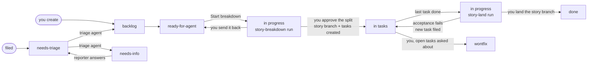

# Task Types And Statuses

> **Proposal, 2026-11-17; open questions decided 2026-11-19; epic added 2026-11-27** (see [Decisions](#decisions-2026-11-19)). Still open: [whether you should be able to create statuses](#open-question-should-you-be-able-to-create-statuses-2026-11-27). How Jira builds workflows out of statuses, what Lamproom should take from it, and whether Lamproom should have a **story** type that a flow splits into tasks. Mocked up in [`types.html`](../../mockups/types.html) and [`board.html`](../../mockups/board.html). Nothing here is built: the code has no `tasks` table yet.

**Short answer.**

- Take Jira's **status with a category**. Add the board mockup's **owner** (you, an agent, or a story's tasks) on top.
- **Don't** take Jira's type → workflow map. A project has **one list of statuses**, which are the board's columns. Each type picks only the **flow** its runs use. A status can be limited to some types.
- Skip Jira's habit of drawing every transition. Moves between your statuses are free, and a rule is written only where the move has a condition or a side effect.
- Add **story**, but only as a container. A story's flow ends by producing a list of tasks, not code. Once you approve the split, those tasks run like any other and land into a **story branch**. When the last one is done, the story lands that branch once, after an optional acceptance review.
- Add **epic** above story, as a container only. An epic groups stories. It runs no flow and has no branch, because each story lands its own. Stop at three levels, epic → story → task: no sub-tasks, because a flow's steps already are the sub-tasks.

## How Jira does it

| Concept | What it is in Jira |
|---|---|
| **Status** | A named step, such as *In Review* or *Blocked*. Each status belongs to one of three fixed **categories**: *To Do* (grey), *In Progress* (blue) or *Done* (green). Reports, filters and boards read the category, not the name. |
| **Transition** | A one-way arrow between two statuses. Going back needs a second transition. A **global transition** lets every status move to one target. Team-managed projects start with *all statuses can move to any status*. |
| **Transition rules** | Company-managed projects only. **Conditions** decide who sees a transition and when. **Validators** check input and block the move when they fail. **Post functions** run after the move, for example setting the resolution. |
| **Workflow** | Statuses plus transitions. Company-managed workflows also set a **resolution** when work is done. |
| **Workflow scheme** | Maps each **issue type** to one workflow in a project. Any type without a mapping uses the default workflow. One issue type has exactly one workflow per project. |
| **Issue type hierarchy** | Three default levels: **Epic** (1), standard types such as **Story**, **Task** and **Bug** (0), and **Sub-task** (−1). Premium adds levels above Epic. Types on the same level differ only in their fields, screens and workflow. |
| **Board** | Columns are mapped to one or more statuses. A status that no column maps is left off the board. |

What not to copy:

- **Drawing every arrow.** A company-managed workflow with eight statuses has dozens of transitions, and the editor becomes a hairball. That's why team-managed projects default to "any to any".
- **Indirection.** Behind every project sit a workflow scheme, a screen scheme, an issue type scheme and a field configuration scheme. Lamproom needs one table.
- **Statuses shared by every project.** In company-managed Jira, renaming a status renames it everywhere.

## What Lamproom has today

- **One list of statuses**, from the [board mockup](../../mockups/board.html). You manage `backlog`, `ready-for-agent`, `ready-for-human`, `done` and `wontfix`. Agents manage `needs-triage`, `needs-info`, `needs-context` and `in progress`. The move rules (`canMove`) already behave like Jira's transition rules:
  - Only *Start run* puts a card in progress, which works like a **condition**.
  - The triage agent checks every card moved to `ready-for-agent`, which works like a **validator**.
  - The provider command queued after each move works like a **post function**.
- **One default flow per project.** A task pins a version of it ([[Project Default Flow]]). The docs list "several flows per project" as a gap.
- **No task type and no parent task**, neither in the [[Intake Data Model]] nor in the code.

Lamproom has a layer Jira doesn't: the **flow**. In Jira, a team adds statuses such as *In Review* or *QA* inside the In Progress category. In Lamproom, those are the steps of a run, shown as the flow bar on an `in progress` card. **Don't turn flow steps into statuses.** Statuses say who holds the card. Steps say what the run is doing.

## Jira → Lamproom

| Jira | Lamproom (proposed) |
|---|---|
| status | status |
| status category | `category`: `todo` · `doing` · `done`. Drives roll-up, reports, and closing the issue on providers that only know open and closed. |
| — | `owner`: `you` · `agent` · `tasks`. Lamproom-only. Decides who may move cards out and whether the column shows by default. |
| transition | A **move rule**. Free between your statuses, and drawn only where a rule applies. |
| condition | Who may make the move, and when (*Start run*, *not blocked*). |
| validator | The triage check on `ready-for-agent`. |
| post function | The provider command, starting a run, or creating a story's tasks. |
| workflow | The project's one status list plus its move rules. There is one per project, not one per type. |
| workflow scheme | **Task types** in project settings: type → flow. A status that only some types use lists them (`in tasks`: story, epic). |
| issue type | task type: `bug`, `task`, `story`, `epic` |
| Epic / Story / Sub-task | epic / story / task. A flow's steps sit below a task. |

## Statuses: category, owner, rules

Creating a status takes five things:

1. **Name**: kebab-case and unique in the project, because it becomes a markdown heading and a label.
2. **Category**: `todo`, `doing` or `done`.
3. **Owner**: you, or an agent. If an agent owns it, name the agent that moves cards *out*, or cards get stuck.
4. **Types that use it**, which defaults to every type. Untick a type and its cards never go there.
5. **Where cards come from.** Statuses you own get free moves from your other statuses. A status an agent owns needs at least one rule leading into it. Otherwise Lamproom warns that nothing can reach it, the same way flow validation warns about a step nothing feeds.

Where a new status lands depends on the issue provider:

| Provider | Status | Type | Children (an epic's stories, a story's tasks) |
|---|---|---|---|
| Markdown backlog | A `## needs-repro` section. Free, because the file is the board. | A class on the bullet: `{#chf-symbol .bug}` | Each child names its parent: `{#amount-minor .task parent=bill-in-currency}`, `{#bill-in-currency .story parent=intl-billing}`. Children can't nest under the parent's bullet, because a card's `##` section is its status. |
| GitHub Issues | A label (`gh label create`). The `done` category closes the issue, and `wontfix` closes it as *not planned*. | GitHub issue type (Bug, Task, Feature; a story maps to Feature unless the org has a Story type; an epic maps to Epic if the org has one, otherwise Feature plus an `epic` label) | Sub-issues, two levels deep |
| Beads | Beads has fixed statuses (`open`, `in_progress`, `blocked`, `closed`). A custom status is a label on the nearest fixed status for its category. | `--type` (`bug`, `task`, `feature`, `epic`, `chore`). A story maps to `feature`, an epic to `epic`. | `parent-child` dependencies |
| Jira (future) | **Jira owns statuses and transitions, so a Jira admin creates each Lamproom status there by hand**, with the same name (case ignored) and the same category, and lets every status move to it. Lamproom matches 1:1 by name: no mapping, no labels. *Sync now* lists any status Jira lacks or files under another category, and cards in it don't go out until it exists. | Native issue type, Epic included | An epic's stories are its children. A story's tasks are Sub-tasks, which have their own workflow in Jira. |

The exact `bd` commands are illustrative, as in the board mockup.

## Move rules: open by default

- **Free moves** between statuses you own, and out of an agent's status into one of yours, as in the board mockup today.
- **Rules** only where something happens, and those are what the status graph draws:
  - `needs-triage → *`: the triage agent.
  - `ready-for-agent → needs-context`: the check fails.
  - `ready-for-agent → in progress`: Start run, once the check has passed and nothing blocks the card.
  - `in progress → done`: the run lands.
- The status graph hides free moves. A toggle draws them, which shows why Jira users stop drawing them.

## Task types

| Type | Default flow | What it is |
|---|---|---|
| `bug` | `bugfix` (proposed: reproduce with a failing test → fix → check → review ✋) | Something is broken. The flow proves it before fixing it. |
| `task` | `software-delivery` v4 | A change with a clear ask |
| `story` | `story-breakdown` (proposed: research → split → approve ✋), then `story-land` (acceptance, if on → land ✋) | User-facing value too big for one run. It never builds code itself. |
| `epic` | none | A goal bigger than one story. It only groups stories. |

- **Four types.** A spike is a task whose flow ends in a report, and a chore is a task. Types are rows, so a project can add one later.
- **Who sets the type:** you, when you create a card. Otherwise the importer, or the triage agent while it reads `needs-triage`, decides it along with where the card goes.
- **Every type shares the project's statuses.** Bug and task differ only in the flow they run. A story also gets `in tasks` and the land step, because it's a container. An epic uses `backlog`, `in tasks`, `done` and `wontfix` only, because it never runs: `needs-context`, `ready-for-agent` and `in progress` are limited to the other three types. Those are rules in code, not something you configure.
- **The project's `default_flow_id`** stays as the fallback for a type without its own flow.

## Should Lamproom have a story type?

**Yes, as a container.**

For:

- **Agents do best on small, well-scoped tasks.** A story is the unit people think in. Splitting it into tasks the agents can run is real planning work, and it's the work the plan step of `software-delivery` already does, only one level up.
- **Parallel runs.** Each task gets its own worktree and branch, cut from the story branch, so independent tasks run side by side. Each one lands into the story branch as a small change that's easy to review.
- **Every provider already has parent and child issues.** GitHub has sub-issues, Beads has epics with `parent-child`, Jira has sub-tasks and epic children, and Linear has sub-issues. Lamproom doesn't invent a structure, it maps onto one.
- **A role flow already writes stories.** The business-analyst flow in [[Role Starter Flows]] ends with *"write user stories with acceptance criteria"*. A story type gives that output somewhere to go.

Risks, and the answer to each:

| Risk | Answer |
|---|---|
| Nobody checks the story as a whole once each task has landed alone | An **acceptance review**, opt-in per story. When the last task is done, `story-land` reviews the story branch against the acceptance criteria before the land gate. A failure files a new task under the story and sends the story back to `in tasks`. |
| Half a feature reaches the default branch | The **story branch**. Tasks land into `story/<id>-<slug>`, and the default branch only sees the story once you land it. |
| The story branch drifts from the default branch | Lamproom merges the default branch into the story branch before each task branches off it and again before landing. A conflict stops the run at the land gate. |
| Tasks depend on each other | The split step writes `after:` dependencies. A task stays blocked until the task it depends on is done, like Beads' `blocked` in the board mockup. |
| The split is too fine or too coarse | The **approve** gate. You see the list before anything is created, and you can send it back with a note. |
| Duplicate issues | The split step reads the open issues and **links** a matching one instead of creating it again. In the mockup, #224, #219 and #231 already exist. |
| Cost: one breakdown run, then a run per task | The story shows the sum of its tasks' spend. A per-story cap could reuse the project budget, later. |
| Hierarchy creep: initiatives, sub-sub-tasks | Three levels. An epic holds only stories, a story holds only tasks and bugs, and a task holds nothing. A flow's steps are the sub-tasks. |

### How a story moves



- **The split step's output is a `task_list` artifact** in [[Backlog File Shapes|Shape B]] markdown. Approving the gate passes it to the existing backlog-importer path, with `parent_id` set to the story. Nothing new parses it.
- **Approving offers two choices.** *New tasks to backlog* keeps "nothing runs until you move it" true. *Queue in ready-for-agent* is for when the split is the go-ahead.
- **Approving creates the story branch** `story/<id>-<slug>` off the default branch. Every task and bug under the story branches off it and lands into it through the usual land step.
- **`in tasks` is a status** in the `doing` category, owned by `tasks`. You can see it, but you can't drag a card into it or out of it. The story moves on by itself when its last task is done or wontfix, as long as at least one task is done.
- **Then the story runs `story-land`** and sits in `in progress` again. If the story has **acceptance review** ticked, a reviewer checks the story branch against the acceptance criteria first. Either way the run stops at the **land** gate, the same approval as landing a task on `/workspaces/land`, and landing it moves the story to done.
- **A bug inside a story** keeps its own `bugfix` flow and counts in the roll-up like a task, but it lands into the story branch too. A bug that hurts production now belongs outside the story, so it lands on its own.
- **A story moved to `wontfix`** asks what to do with its open tasks: close them too, or keep them as stand-alone tasks. The story branch is kept until you delete it.

### How an epic moves

- **An epic starts in `backlog`.** Giving it its first story moves it to `in tasks`. You, the triage agent, or a role flow such as the business analyst's add stories to it.
- **It moves to `done` by itself** when its last story is done or wontfix, as long as at least one story is done. Nothing runs and nothing lands, because each story already landed its own branch.
- **You can't move an epic to `ready-for-agent`.** The board says to open one of its stories instead.
- **An epic moved to `wontfix`** asks the same question a story does, about its open stories.

## Data model (proposal)

```sql
ALTER TABLE tasks ADD COLUMN type      TEXT NOT NULL DEFAULT 'task';   -- 'bug'|'task'|'story'|'epic'
ALTER TABLE tasks ADD COLUMN parent_id TEXT REFERENCES tasks(id);      -- a story's epic, or a task's or bug's story; null otherwise
ALTER TABLE tasks ADD COLUMN acceptance INTEGER NOT NULL DEFAULT 0;    -- stories only: run the acceptance review before landing
ALTER TABLE tasks ADD COLUMN branch    TEXT;                           -- stories only: story/<id>-<slug>, set when the split is approved

CREATE TABLE statuses (                 -- per project: renaming one never touches another project
  project_id TEXT NOT NULL REFERENCES projects(id) ON DELETE CASCADE,
  name       TEXT NOT NULL,             -- kebab-case; becomes the heading or label
  category   TEXT NOT NULL,             -- 'todo'|'doing'|'done'
  owner      TEXT NOT NULL,             -- 'you'|'agent'|'tasks'
  agent      TEXT,                      -- who moves cards out when owner = 'agent'
  means      TEXT,                      -- the one line under the column name
  types      TEXT,                      -- JSON list of types that use it; null = every type
  PRIMARY KEY (project_id, name)
);

CREATE TABLE task_types (               -- which flow each type runs; statuses are shared
  project_id TEXT NOT NULL REFERENCES projects(id) ON DELETE CASCADE,
  type       TEXT NOT NULL,
  flow_id    TEXT REFERENCES flows(id), -- null → projects.default_flow_id
  land_flow_id TEXT REFERENCES flows(id), -- story only: runs when the last task is done (story-land)
  PRIMARY KEY (project_id, type)
);
```

- `tasks.status` keeps its column. Its values become this table's names, not a fixed list.
- **Move rules** stay in code for the built-in statuses. Custom statuses get free moves plus the "where cards come from" list. Turning rules into data is premature until custom rules exist.

## Decisions (2026-11-19)

Alex answered the six open questions:

1. **Story acceptance review: yes, opt-in per story.** A checkbox on the story. When it's ticked, `story-land` reviews the story branch against the acceptance criteria before the land gate.
2. **Story branch, not the default branch.** Tasks land into `story/<id>-<slug>`. The story lands it once, after acceptance, and you approve the land, the same as landing a task.
3. **Four types: bug, task, story, epic.** *(Changed 2026-11-27; it was three, with no epics.)* An epic groups stories and runs no flow.
4. **A bug inside a story is allowed** and keeps its own flow.
5. **The board shows every type together** with the `in tasks` column, plus a type filter (all · bug · task · story · epic) that only changes the view. *(Added 2026-11-23, epics 2026-11-27.)* **Inside each column, cards are grouped** under their epic, then their story. Each header shows the id, title, progress across all its children, and the status the epic or story itself is in. Click the chevron to fold a group, or the title to open it. Cards with neither come after the groups, under "no epic or story". A story that hasn't been split yet is an ordinary card that says "not split yet". Every group starts folded. *(Added 2026-11-27.)* **An epic picker** sits next to the type filter: with *all epics* the board looks as described above, and with one epic picked, only its stories and tasks show, grouped by story, with no epic level. There are no board-wide swimlanes. **Containers look like containers:** an epic is a dark-tinted box with a black **EPIC** tag, a story a lighter box with an outlined **STORY** tag, and the tasks inside stay white cards.
6. **Jira: a Jira admin creates Lamproom's statuses in Jira by hand.** Lamproom matches them 1:1 by name. No mapping several onto one, and no `lamproom:<status>` label.
7. **No status workflow per type** (asked afterwards). One status list per project, and a type picks only its flow. "Workflow" stays the name for flows, as on `/settings/workflows`.

Calls made while writing these in, not yet reviewed:

- `story-land` runs in `in progress` rather than in a new status, because statuses say who holds the card and the run holds it.
- A failed acceptance review files a task under the story and sends the story back to `in tasks`.
- Lamproom merges the default branch into the story branch before each task branches off and before landing.
- A bug under a story lands into the story branch, so an urgent bug belongs outside the story.
- *(2026-11-27)* An epic holds stories only, never a task directly: a task that belongs to an epic belongs to one of its stories.
- *(2026-11-27)* An epic runs no flow for now. A later `epic-breakdown` could split an epic into stories the way `story-breakdown` splits a story into tasks.
- *(2026-11-27)* On GitHub an epic is an Epic issue type if the org defines one, otherwise a Feature with an `epic` label.
- Jira statuses match by name with case ignored (`in progress` = *In Progress*), and the category must match too.

## Open question: should you be able to create statuses? (2026-11-27)

Raised 2026-11-27. Not decided, and the mockups keep the **New status** form until it is. The concern isn't about types or the built-in statuses. It's about letting a project add its own statuses.

**Keep types.** Everything else on the board depends on them:

- A type picks the flow a run uses: `bugfix`, `software-delivery`, `story-breakdown` then `story-land`, or none for an epic.
- Type plus `parent_id` is what the board's epic → story → task groups, the epic picker and `in tasks` are built on.
- Every provider already has types (GitHub issue types, Beads `--type`, Jira issue types, a markdown class), so they map rather than invent.

**Keep the built-in statuses, as a fixed list.** Each one says who holds the card (you, an agent, or its children), and the move rules hang off that. The triage agent, the context check, *Start run* and the story and epic roll-up all assume these ten.

**Custom statuses may not be worth it.**

- **Lamproom already has a place for them.** Jira teams mostly add statuses such as *In Review* or *QA* to track steps of the work. In Lamproom those are a flow's steps, shown on the running card's bar, and this note already says not to turn flow steps into statuses.
- **Each one is expensive on a provider.** Beads can't add a status, so it rides as a label. In Jira an admin creates it by hand. On GitHub it's one more label to keep in sync. Lamproom also has to check that some agent moves cards out of it.
- **Nobody has asked for one yet.** Adding the form later is cheap, because statuses already sit in a per-project `statuses` table in this proposal. Taking it away once projects rely on it isn't.

**If we drop them:** `types.html` becomes a **task types** page where each type picks its flow, and epic shows "no flow". The status graph stays as a read-only explanation of the columns and who moves cards between them. The **New status** form and the per-status "used by" ticks go. Which statuses a type uses becomes a rule in code, the way `in tasks` is already limited to stories and epics.

## Sources

- [Workflows and statuses for boards in business spaces](https://support.atlassian.com/jira-software-cloud/docs/workflows-and-statuses-for-boards-in-business-projects/): status categories.
- [What are work item statuses, priorities, and resolutions?](https://support.atlassian.com/jira-cloud-administration/docs/what-are-issue-statuses-priorities-and-resolutions/)
- [Manage how work flows in your team-managed space](https://support.atlassian.com/jira-software-cloud/docs/manage-how-work-flows-in-your-team-managed-project/)
- [Manage work item transitions in team-managed spaces](https://support.atlassian.com/jira-software-cloud/docs/create-edit-and-delete-transitions-in-team-managed-projects/): one-way transitions.
- [Configure advanced work item workflows](https://support.atlassian.com/jira-cloud-administration/docs/configure-advanced-issue-workflows/): conditions, validators, post functions.
- [Configuring workflow schemes](https://confluence.atlassian.com/adminjiraserver/configuring-workflow-schemes-938847421.html): issue type → workflow, default workflow.
- [Configure the work type hierarchy](https://support.atlassian.com/jira-cloud-administration/docs/configure-the-issue-type-hierarchy/): epic, standard, sub-task levels.
- [What are Jira workflows?](https://www.atlassian.com/software/jira/guides/workflows/overview)

## Related

- [[Board Projection]]
- [[Project Default Flow]]
- [[Role Starter Flows]]
- [[Artifact Contract]]
- [[Backlog File Shapes]]
- [[TaskSource Port]]
